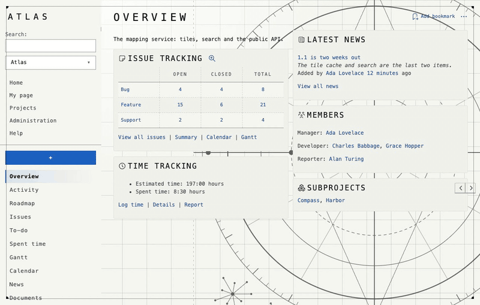
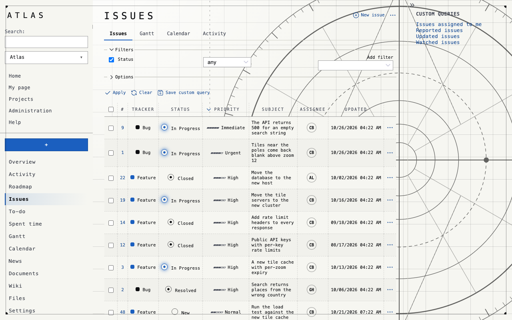
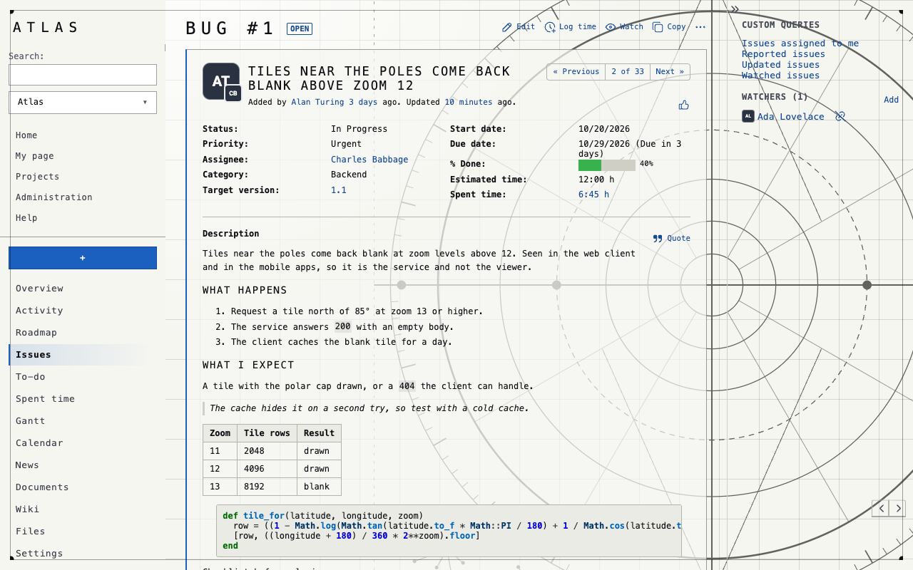
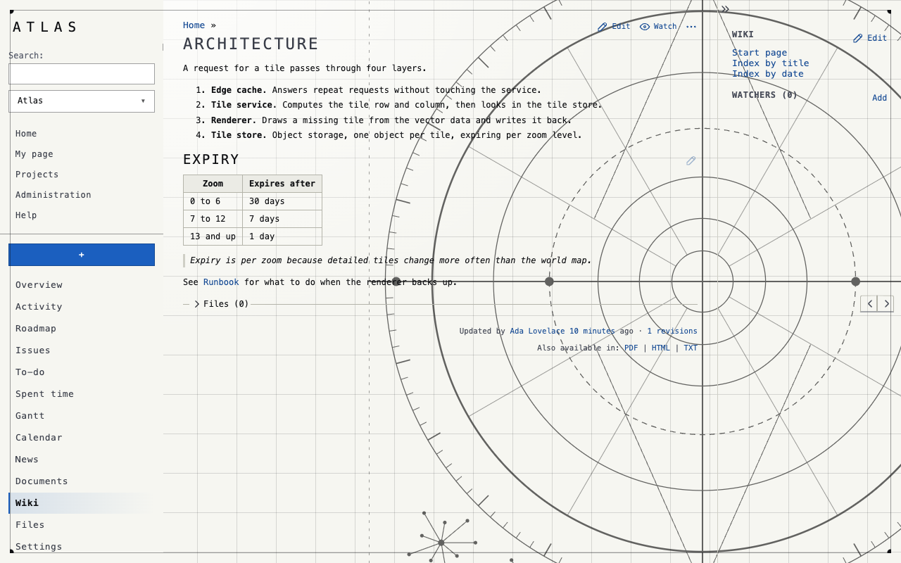
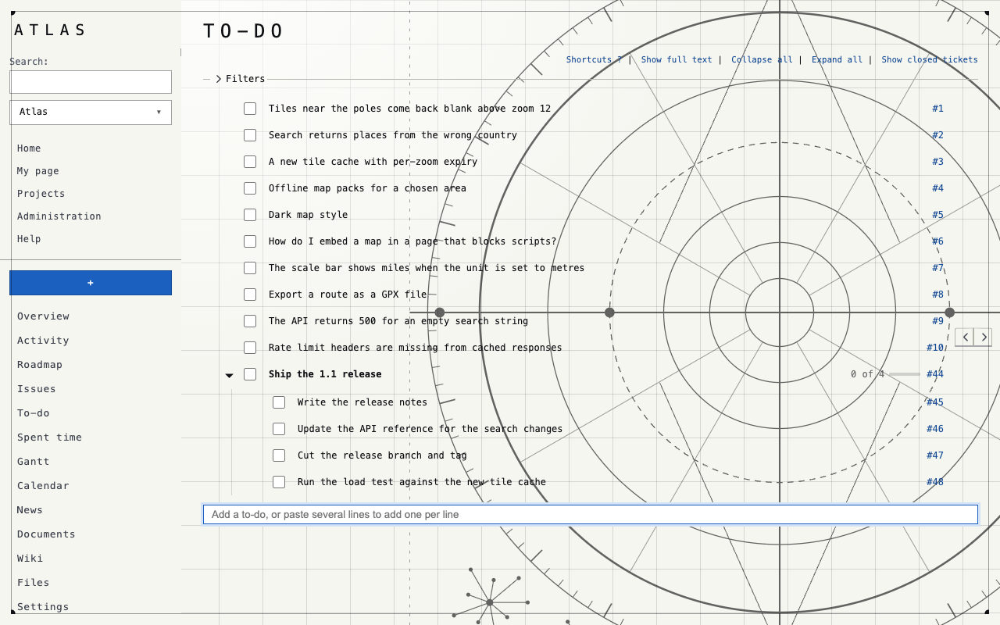
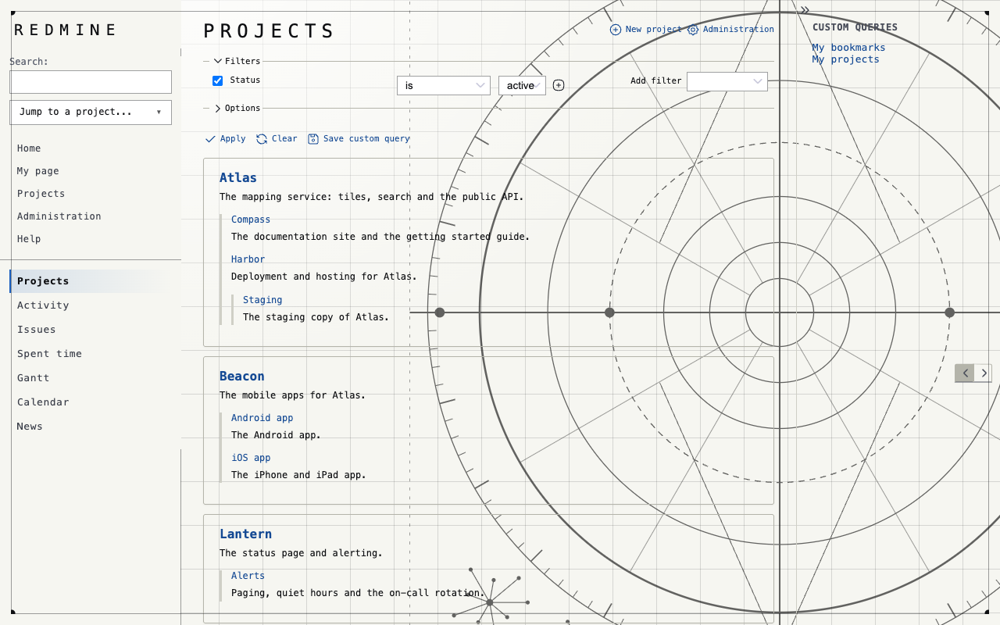
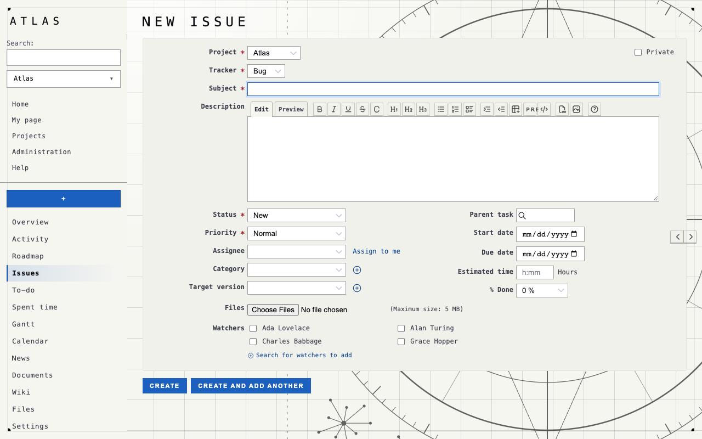
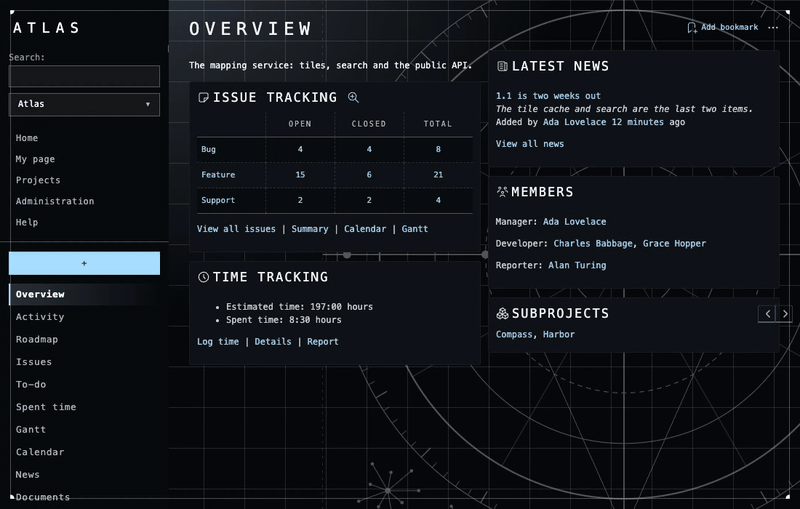
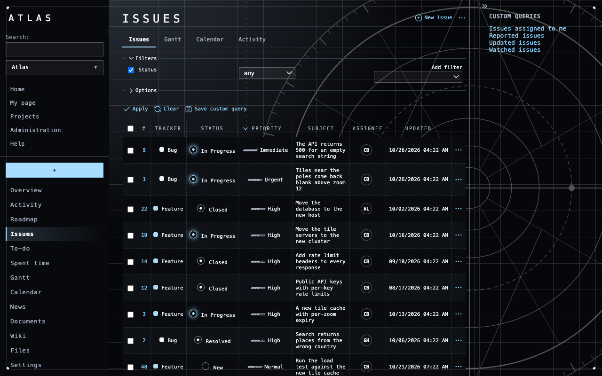
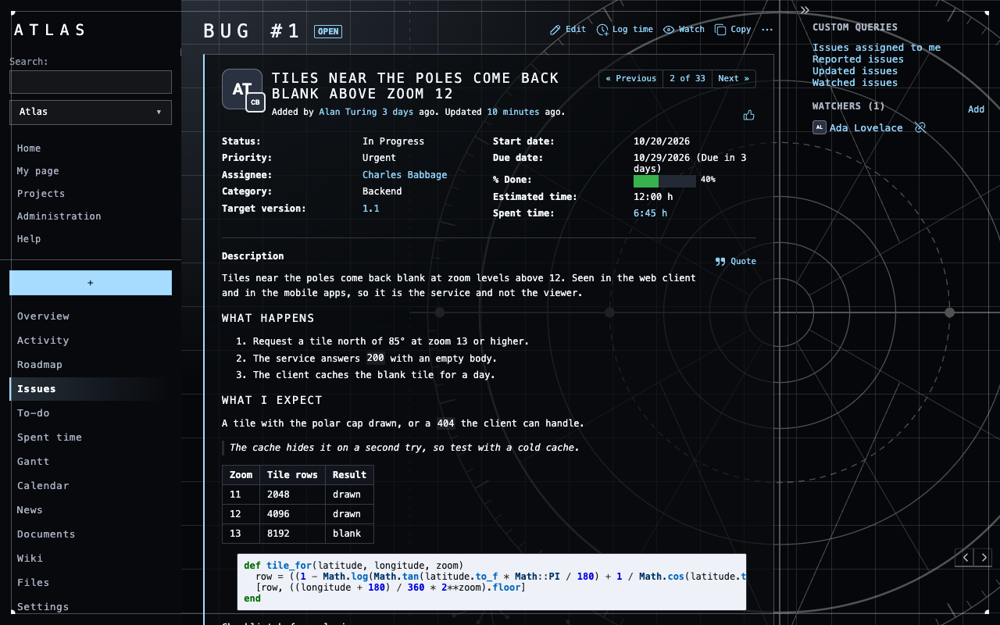

# Meteorite for Redmine

A space print: near black, hairlines, rings and small mono labels.

A theme for Redmine 7 and up. It is CSS plus one small script (`javascripts/theme.js`), with no plugin and no change to Redmine itself. The script only reads the page: it adds initials next to assignees, a colour hook on status group headers and a row of view tabs. Without the script the theme still works, with plainer lists. Meteorite is a dark theme first. With a light system setting it switches to a white print, black lines on white paper (see [Dark mode](#dark-mode)). The screenshots marked light are the white print.



| | |
|---|---|
|  |  |
|  |  |
|  |  |

Dark mode:



| | |
|---|---|
|  |  |

## Contents

- [Install](#install)
- [What is covered](#what-is-covered)
- [Dark mode](#dark-mode)
- [Compatibility](#compatibility)
- [Development](#development)
- [License](#license)
- [Disclaimer](#disclaimer)

## Install

1. Copy the `meteorite` folder from this repository into the `themes` folder of your Redmine.
2. Restart Redmine.
3. In Administration, Settings, Display, choose **Meteorite** as the theme and save.

To go back, choose another theme on the same page. Nothing is written to the database apart from that setting.

## What is covered

The header and menus, the sidebar, the issue list, the issue page with its history, the new and edit forms, buttons, flash
messages, tables, tabs, the context menu and the login page, in light and dark. Other pages (Gantt, calendar, wiki, administration)
take their colours from the same variables and are fixed up as problems turn up.

## Dark mode

Meteorite is black by default. With a light system setting it becomes a white print, with the same drawing in black lines. If you would rather the theme stayed black, delete the `@media (prefers-color-scheme: light)` block at the end of `meteorite/stylesheets/application.css`; every rule for the white print is in that one block.

## Compatibility

Redmine 7.0 and newer. Tested on 7.0.2 and the 7.0 line. Older versions are not expected to work.

## Development

You need Docker, Ruby, Node and Chrome.

```
npm install
ruby bin/demo up        # a throwaway Redmine with demo data at http://localhost:3107 (admin / admin)
npm run check           # loads every page in light and dark, at desktop and phone width
npm run screenshots     # docs/screenshots
npm run record          # docs/demo, a GIF of a walk through the pages
ruby bin/demo reset     # wipe the demo
```

If a copy of the Rubylode to-do plugin sits next to this repository (`../redmine-rubylode-todo`, or set `TODO_PLUGIN_PATH`), the demo mounts it and
the check, screenshots and recording include its page. Without it they skip that page.

The check fails on console errors, failed requests, sideways scrolling and text below WCAG AA contrast. `REDMINE_TAG=7.0 ruby bin/demo up`
runs it against another Redmine version. After you change the stylesheet, run `ruby bin/demo restart` and reload: Redmine caches theme
files until it restarts.

## License

GPL version 2 or later, the same as Redmine. See `LICENSE`. Copyright (C) 2026  Nick Gorbikoff.

## Disclaimer

Use at your own risk. This software is provided as is, without warranty of any kind, express or implied. The author is not
liable for any damage, data loss or downtime that comes from using it. Try it on a copy of your tracker before you use it on the
real one.
